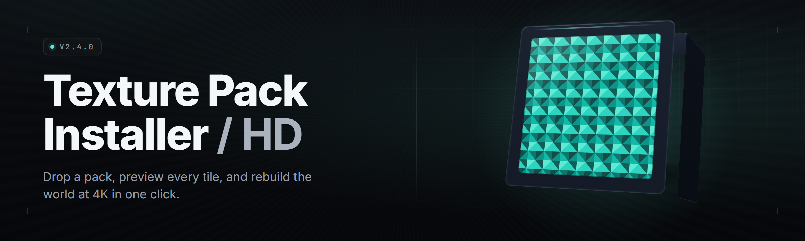

  
  
  

  

  
  
  

---

`hd-texture-pack-installer` is a Windows `.exe` that takes the guesswork out of installing HD retexture packs. You point it at a downloaded archive or a folder of loose DDS/PNG/TGA files, it inspects the target game, decides where every texture belongs, resolves conflicts between overlapping packs, and installs everything in an order the engine will actually load. No reading a 40-page forum thread. No manually renaming ten thousand files. No half-installed pack that breaks the skybox.

It reads the same modding conventions the community already uses — archive layout, folder naming, texture path hints, pack metadata — and turns them into a deterministic install plan. Then it writes the files, backs up what it overwrites, and leaves you with a one-click restore if the result looks wrong.

Under the hood it's a texture-aware installer: it parses DDS headers to confirm format and mip levels, matches textures to the target game's file paths, deduplicates identical files across packs, and keeps a manifest so every install is reversible.

---

## 🗂️ Table of Contents

- [What is the HD Texture Pack Installer](#-what-is-the-hd-texture-pack-installer)
- [Compatibility](#-compatibility)
- [The Problem](#-the-problem)
- [The Solution](#-the-solution)
- [🧩 Comparison: This Tool vs The Old Way](#-comparison-this-tool-vs-the-old-way)
- [Core Modules](#-core-modules)
- [Install Pipeline Modules](#-install-pipeline-modules)
- [Pack Parsing Modules](#-pack-parsing-modules)
- [Conflict & Load-Order Modules](#-conflict--load-order-modules)
- [Verification & Restore Modules](#-verification--restore-modules)
- [All Modules Status](#-all-modules-status)
- [Quick Start](#-quick-start)
- [Usage guidelines](#-usage-guidelines)
- [System Requirements](#-system-requirements)
- [Installation](#-installation)
- [Known Issues](#-known-issues)
- [FAQ](#-faq)
- [What is … — Glossary](#-what-is--glossary)

---

## 🎮 Compatibility

The installer ships with first-class profiles for the engines below. "Profile" means the tool already knows the folder layout, texture extension, and override precedence for that engine, so you don't configure anything.

| Engine / Game | Texture Format | Profile Maturity | Notes |
|---|---|---|---|
| Unreal Engine 4 / 5 | `.uasset` + loose DDS | Stable | Loose-file override + pak-aware merge |
| Unity (Mono/IL2CPP) | `_data` assets + PNG | Stable | Reads Data folder, respects load order |
| Source (Source 1 / Source 2) | `materials/` VMT + VTF | Stable | Writes to `custom/`, non-destructive |
| Creation Engine (Skyrim/Fallout) | `.dds` via `textures/` | Stable | BSA-aware, loose-file wins by default |
| REDengine (Witcher 3) | `.dds` in `content/` | Stable | Mod-folder target supported |
| GTA V (RAGE) | `.ytd` DDS | Beta | Mods-folder mode only |
| Blizzard (CASC) | DDS + CASC index | Beta | Requires extracted index |
| Generic "loose files" | Any DDS/PNG/TGA | Stable | Fallback profile for anything else |

---

## 🕳️ The Problem

Hunting down and installing an HD texture pack is still, in 2026, an exercise in forum archaeology. The pain is specific and it's everywhere:

- **Pack instructions are a maze.** Every uploader documents their pack differently — one says copy to `textures/`, another says drop in `Data/`, a third buries the real path inside a README's tenth paragraph. Get it wrong and nothing changes on screen.
- **Conflict resolution is manual.** Install two packs that touch the same texture and you're hand-picking winners file by file, or guessing which folder the engine reads last.
- **Load order silently decides everything.** Install packs in the "wrong" order and the engine happily loads the older, lower-res texture over the HD one you just paid attention to.
- **No clean undo.** Overwrite a vanilla file with no backup and the only fix is a multi-gigabyte game reinstall or a "verify integrity" roulette.
- **Bad archives pass silently.** A truncated download or an archive full of 1-pixel placeholder textures installs fine and looks broken, and nothing tells you which file is the problem.
- **Mip levels and formats vanish.** A bump-map saved as sRGB DDS, or a normal map with the wrong compression, loads as a muddy gray smudge and you never find out why.
- **Manual installs don't scale.** A 12 GB pack with 30,000 files is not a drag-and-drop job, and copying it by hand takes longer than the download did.

> Every one of these is a solvable file-management problem. The installer solves them once so you don't solve them per-pack.

---

## 🔧 The Solution

Each pain point maps to a module that already exists in the tool. This table mirrors the list above one-to-one.

| Pain Point | How the Installer Solves It |
|---|---|
| Pack instructions vary wildly | Reads archive layout + pack metadata and auto-detects the correct target path for the selected profile |
| Manual conflict resolution | Conflict Resolver detects overlapping textures and applies a deterministic, editable winner rule |
| Load order decided by luck | Load Order Planner writes explicit precedence so higher-res, newer packs win by default |
| No clean undo | Every overwritten file is backed up and tracked in a reversible manifest — one-click restore |
| Silent bad archives | Pre-flight validation checks archive integrity, texture dimensions, and format before touching the game |
| Wrong format / mip levels | DDS Parser flags sRGB-vs-linear, missing mips, and unsupported compression on every texture |
| Manual install doesn't scale | Batch engine installs tens of thousands of files with progress, dedup, and per-file logging |

---

## 🧩 Comparison: This Tool vs The Old Way

Fair framing, no strawmen. Manual install is fine for one small pack on one game. It falls apart the moment you scale.

| Aspect | Manual / Buy-a-pack route | This Installer |
|---|---|---|
| Setup effort | Read a thread, find paths, copy by hand | Point at archive, pick profile, click Install |
| Conflict handling | Rename files one by one | Editable winner rule, applied automatically |
| Load order | Trial, error, restart, error again | Explicit manifest — deterministic precedence |
| Rollback | Game reinstall or verify-integrity | One-click restore from tracked backup |
| Bad files caught | Never, until you see the smudge | Pre-flight format + dimension validation |
| Large packs (10k+ files) | Hours of copying | Batch engine, progress bar, no manual step |
| New game later | Re-learn the layout from scratch | Pick a different profile, everything else identical |
| Cost | Varies; premium packs charge for convenience | Free, MIT-licensed, community-maintained |

---

## 🧱 Core Modules

The installer is split into small modules that each do one job. The first group is the application itself — the UI, the engine, and the config layer.

1. **Profile Manager** — Loads, edits, and switches engine/game profiles; each profile defines texture extension, target paths, and override precedence. Ships with the profiles from the compatibility table, and you can fork one for a niche game.
2. **Archive Inspector** — Detects archive type (ZIP/7z/RAR/tar) and previews contents, target-path hints, and total texture count *before* anything is extracted.
3. **Destination Resolver** — Maps each texture in a pack to its correct on-disk location for the active profile, using folder names, texture filenames, and pack metadata.
4. **Batch Install Engine** — Streams files to disk in dependency order, deduplicates identical textures across packs, and reports per-file progress plus a final summary.
5. **Config & Presets Store** — Keeps your profile choices, conflict rules, and load-order decisions as editable presets so a repeat install is two clicks.

---

## ⚙️ Install Pipeline Modules

This group is the machinery that runs once you press Install. It's the part that decides *what actually lands on disk.*

1. **Overwrite Guard** — Before any write, checks whether the destination exists, and if so snapshots the original into the backup store. Nothing irreversible happens without a copy first.
2. **Backup Store** — Content-addressed backup of every overwritten vanilla file, deduplicated by hash, so multiple packs sharing a file only store it once.
3. **Manifest Writer** — Records every install as a JSON manifest: pack id, file hash, source, destination, and timestamp. One manifest per install, one line per file.
4. **Rollback Engine** — Reads a manifest and reverses it exactly — restores originals, removes installed files, repairs any half-written state if the run was interrupted.
5. **Progress & Logging** — Live progress with throughput and ETA, plus a rotating text log you can hand to a pack author when something misbehaves.
6. **Dry-Run Mode** — Runs the whole pipeline but writes nothing, giving you the resolved plan as a table first so you can review before committing.

---

## 📦 Pack Parsing Modules

This is where archives become installable data. Parsing is the difference between "it copied files" and "it installed the pack correctly."

1. **DDS Parser** — Reads the DDS header: format, dimensions, mip count, and whether the texture is sRGB or linear. Flags missing mips and every unsupported compression on load.
2. **Texture Decoder** — Decodes PNG/TGA/DDS metadata into a common descriptor so the tool can compare textures across packs by size, format, and hash.
3. **Metadata Reader** — Parses pack-provided `info.json`, `manifest.txt`, and common README path hints to inform the Destination Resolver.
4. **Filename Normalizer** — Handles case differences, whitespace, and the Unicode dashes forum posts love, so `Sky_04.dds` and `sky_04.DDS` resolve to the same texture.
5. **Texture Hash Index** — Builds a content hash per texture so duplicates across packs are detected and never installed twice.

---

## 🔀 Conflict & Load-Order Modules

Two HD packs will always fight over the same file. This group makes the winner predictable and editable instead of accidental.

1. **Conflict Resolver** — Detects every texture targeted by more than one file and surfaces a conflict list with a default winner rule you can override per texture or per pack.
2. **Load Order Planner** — Assigns explicit precedence values and writes them to the manifest and the engine-appropriate order file so the higher-res, newer pack wins by default.
3. **Precedence Rules** — Built-in rules (highest resolution wins, newest pack wins, user-pinned pack wins) with a custom-rule slot for anything the defaults don't cover.
4. **Override Reporter** — Before install, prints exactly which textures will be overridden and by which pack, so "why does this one tree look low-res" never happens again.

---

## ✅ Verification & Restore Modules

The last group is the safety net. It checks that what you downloaded is worth installing, and it lets you get back to vanilla in one click.

1. **Pre-flight Validator** — Confirms archives aren't truncated, textures aren't 1-pixel placeholders, and no path escapes the target directory via `../`.
2. **Post-install Verifier** — Re-hashes installed files against the manifest and reports any texture that landed truncated or mismatched.
3. **Restore Wizard** — One click to roll back the last install, or pick any previous manifest from history and restore to that exact state.
4. **Integrity Report** — Generates a shareable summary of what was installed, what was skipped, and what conflicted, for bug reports and pack-author feedback.

  

---

## 📋 All Modules Status

Every module above, in one place, with honest status. ✅ means it's working and shipping.

| Module | Status | Description |
|---|---|---|
| Profile Manager | ✅ Working | Engine/game profiles for paths, extension, precedence |
| Archive Inspector | ✅ Working | Detects archive type, previews contents before extract |
| Destination Resolver | ✅ Working | Maps each texture to its correct target path |
| Batch Install Engine | ✅ Working | Streams files, dedupes, reports progress |
| Config & Presets Store | ✅ Working | Saves profile choices and rules as presets |
| Overwrite Guard | ✅ Working | Snapshots originals before any overwrite |
| Backup Store | ✅ Working | Content-addressed, deduplicated backups |
| Manifest Writer | ✅ Working | JSON manifest per install, one line per file |
| Rollback Engine | ✅ Working | Exact reversal from manifest |
| Progress & Logging | ✅ Working | Live progress + rotating text log |
| Dry-Run Mode | ✅ Working | Full plan, zero writes |
| DDS Parser | ✅ Working | Header, format, mip, and colorspace detection |
| Texture Decoder | ✅ Working | Common descriptor across PNG/TGA/DDS |
| Metadata Reader | ✅ Working | Parses pack info/manifest/readme hints |
| Filename Normalizer | ✅ Working | Case, whitespace, Unicode dash handling |
| Texture Hash Index | ✅ Working | Content-hash dedupe across packs |
| Conflict Resolver | ✅ Working | Detects overlaps, editable winner rule |
| Load Order Planner | ✅ Working | Writes explicit precedence to manifest/order file |
| Precedence Rules | ✅ Working | Resolution/newest/pinned defaults + custom slot |
| Override Reporter | ✅ Working | Pre-install list of what gets overridden and by whom |
| Pre-flight Validator | ✅ Working | Truncation, placeholder, and path-escape checks |
| Post-install Verifier | ✅ Working | Re-hashes files against the manifest |
| Restore Wizard | ✅ Working | One-click restore to last or any prior manifest |
| Integrity Report | ✅ Working | Shareable install/skip/conflict summary |
| Batch Progress Reporter | ✅ Working | Throughput and ETA for large packs |
| CASC Index Reader | 🟡 Beta | Blizzard CASC profile, requires extracted index |

---

## 开始 Quick Start

Five steps. This is the whole process.

1. Open the project page and grab the current build from the download section. 💾
2. Extract the archive to a folder you can find again — the `.exe` lives in the extracted folder. 📁
3. Run the `.exe`. First launch has no install step; it just opens. 🎮
4. Pick your game from the profile list, then point the tool at your downloaded HD pack archive or folder. 🎨
5. Review the resolved plan, click **Install**, and launch your game. Everything is backed up and reversible. ✅

---

## 🚦 Usage guidelines

Short and unambiguous. This tool edits files on your own machine; it doesn't touch anything online.

**Allowed**

- Installing HD texture packs you downloaded or made yourself into your own game installs.
- Backing up, verifying, and restoring your own game texture files.
- Repacking, merging, and load-order-editing packs for personal use.
- Forking the profile for any game you own and playing with the layout.

**Not allowed**

- Redistributing a paid pack you didn't author.
- Bundling ripped textures into a commercial release.
- Using the tool to write into directories you don't control.

> You're responsible for the packs you install. The tool gives you a clean undo; it can't give you a license for someone else's textures.

---

## 💾 System Requirements

Runs on modern Windows. Nothing exotic required.

| Component | Minimum | Recommended |
|---|---|---|
| OS | Windows 10 (64-bit, 1809+) | Windows 11 (64-bit) |
| CPU | Dual-core 2 GHz | Quad-core 3 GHz+ |
| RAM | 2 GB free | 8 GB free |
| Disk | 1 GB for app + backup headroom | SSD with space for full game + pack backup |
| GPU | Any (no rendering required) | Any |
| Runtime | None — self-contained `.exe` | None |
| Permissions | Standard user for own-library installs | Admin only if game lives under `Program Files` |

---

## 🛠️ Installation

Three steps, sub-stepped. No package manager, no repo checkout.

1. **Get the build.**
   1. Open the project page.
   2. Use the download section to obtain the current build.
   3. Save the archive anywhere — it's self-contained.

2. **Extract and run.**
   1. Extract the archive to a normal folder (not inside the game directory).
   2. Double-click the `.exe`.
   3. If Windows SmartScreen appears, choose **More info → Run anyway** — it's an unsigned community build.

3. **Install your first pack.**
   1. Choose your game from the profile picker.
   2. Drag your HD pack archive or folder into the window.
   3. Review the plan, then hit **Install**.
   4. If the result looks wrong, use **Restore** to go back instantly.

  

---

## 🐛 Known Issues

Live list, updated as fixes ship. Each has a workaround.

| Issue | Solution |
|---|---|
| Antivirus quarantines the `.exe` on first run | Add the extracted folder to your AV exclusion list; the batch write engine can look suspicious to heuristics |
| Install fails with "access denied" on a `Program Files` game | Re-run the `.exe` as administrator, or move the game to a user-writable library |
| CASC profile (Blizzard) rejects a pack | Extract the game's CASC index first — the beta reader needs it present |
| A pack installs but the game shows no change | Check the engine's mod/override folder is enabled; run **Override Reporter** to confirm the pack's textures target real paths |
| Very large pack (>30k files) runs slowly on HDD | Install with the game on an SSD, or use **Dry-Run** first to confirm the plan before the long write |
| Unicode filenames skipped | Enable **Filename Normalizer** strict mode in Config & Presets |

---

## ❓ FAQ

<strong>Do I need to install anything before running the tool?</strong>

No. The `.exe` is self-contained — no runtimes, no package managers. Extract and run.

<strong>Does this work with paid HD packs?</strong>

Yes, it installs any archive you provide. It doesn't distribute packs or bypass any store; you supply your own licensed files.

<strong>Will it break my game?</strong>

Every overwritten file is backed up and tracked in a manifest. If the result is wrong, one click restores vanilla.

<strong>Can I undo a partial install if the tool crashes?</strong>

Yes. The Rollback Engine reads the manifest written before the crash and repairs the half-written state.

<strong>Two of my packs use the same textures — what happens?</strong>

The Conflict Resolver detects the overlap and applies a default winner rule (highest resolution wins). You can override it per texture or per pack before installing.

<strong>Which games are supported?</strong>

The engines in the compatibility table ship as built-in profiles, plus a generic loose-file fallback. You can fork any profile for a niche game.

<strong>How does it decide load order?</strong>

The Load Order Planner writes explicit precedence — newest, highest-resolution pack wins by default, with user-pinned packs overriding everything.

<strong>Does it verify the packs I download?</strong>

Yes. Pre-flight validation checks archive integrity, texture dimensions, and format, and flags truncated or placeholder textures before anything is written.

<strong>Can I review the plan before it changes anything?</strong>

Yes — Dry-Run Mode runs the whole pipeline and writes nothing, giving you the resolved plan as a table first.

<strong>Is it free?</strong>

Yes, MIT-licensed and community-maintained.

---

## 📖 What is … — Glossary

Short definitions for the terms that come up most in this tool and in the HD-pack community. If a term here is unfamiliar, the tool likely has a module that manages it.

| Term | Explanation |
|---|---|
| HD retexture pack | A bundle of higher-resolution texture files that replace vanilla game textures |
| DDS | DirectDraw Surface — the compressed texture format most game engines consume directly |
| Mipmap / mip level | Pre-scaled copies of a texture at smaller sizes; missing mips cause shimmering and pop-in |
| sRGB vs linear | Color-space encoding; swapping them makes colors or normal maps render wrong |
| Load order | The precedence order an engine uses when two files claim the same path; last-loaded wins |
| Override | A loose file that replaces a file packed inside the game's own archives |
| Manifest | The JSON record this tool writes per install, mapping every file to its source and hash |
| Content-addressed backup | Backup storage keyed by file hash, so identical files across packs store once |
| BSA / CASC index | Engine-specific archive containers (Creation Engine / Blizzard) that the installer can read |
| Loose file | A texture written directly to disk instead of inside an engine archive |

---

The installer exists because the HD-pack scene deserves a tool that treats install as an engineering problem instead of a forum scavenger hunt. Profiles know the layout, the conflict resolver makes winners predictable, and every install leaves a manifest you can reverse in one click. Point it at a pack, pick your game, and let the machinery do the filing — your textures land where the engine actually looks, in the order that actually wins. That's the whole job, done once and done clean.
